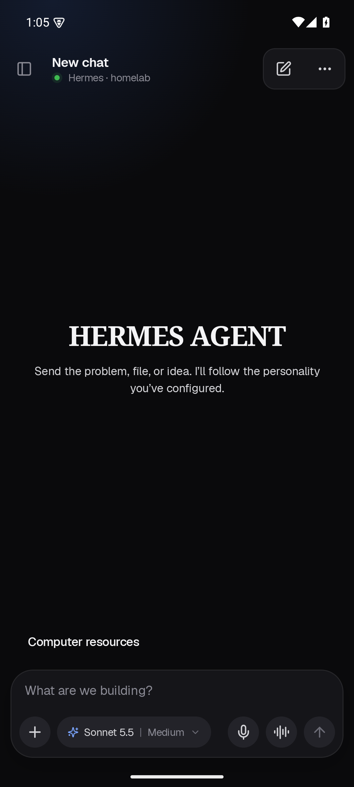
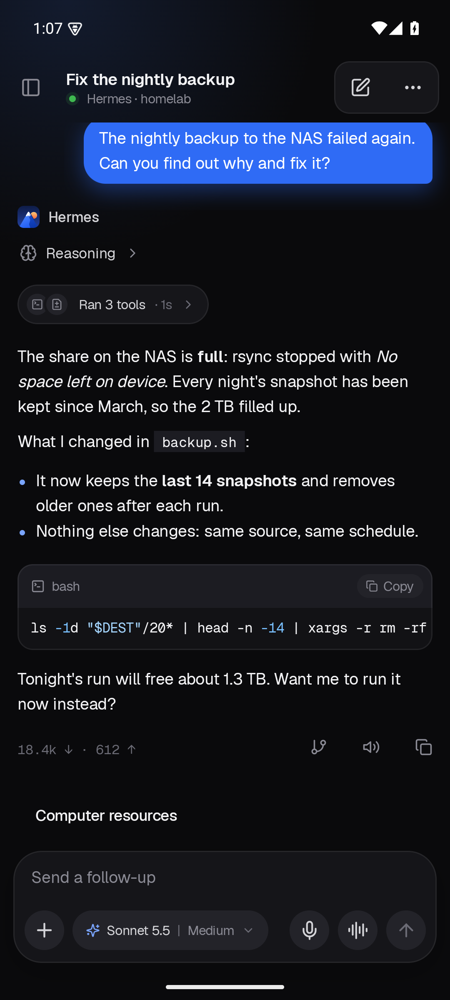
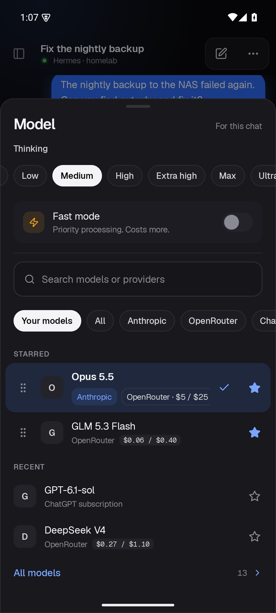

# Hermes Companion for Android

Hermes Companion connects an Android phone to a Hermes Agent gateway. It is based on [Kyllene](https://github.com/Giton22/kyllene) and is under active development.

## Screenshots

Emulator sample screens. The model catalog is illustrative.

| Home | Chat | Models |
| --- | --- | --- |
|  |  |  |
## What works so far

QR pairing and chat have been exercised against a gateway. A local LiteRT-LM model called a photo-counting tool in an emulator; image-copy fixtures also passed checks for original preservation and retry deduplication. These checks do not establish that every model, tool, or phone works.

The app can display local generation speed and a resource panel. Available resource readings depend on the gateway and device. Local folder tools work within the immediate children of a folder you choose; photo tools access the media visible to the app under Android permissions.

On SM-S938U, the app prefers GPU for the full catalog model files and falls back to CPU if GPU initialization fails. Other devices and the compact model use CPU. GPU initialization and fallback have not been verified on SM-S938U hardware.

## Build

Install JDK 25 and Android SDK Platform 37.1, then set up the Android SDK for Gradle through Android Studio or a local `local.properties` file. From the repository root:

```sh
./gradlew :androidApp:assembleDebug
```

On Windows, use `gradlew.bat` in place of `./gradlew`. The debug APK is written under `androidApp/build/outputs/apk/debug/`. The local QA integration fixtures are not included; the QA build configuration alone does not provide the test gateway or its certificate.

## Gateway

Remote chat needs a running [Hermes Agent](https://github.com/NousResearch/hermes-agent) and a reachable gateway. The customized pairing and phone extensions are in `extensions/`. See [gateway setup](extensions/pairing/COMPANION_PLUGIN_SETUP.md). Pairing codes contain credentials; share them only with the device you are connecting.

## Pets

Bring your own pet artwork. Personal artwork is not included in this repository.

## Status

This is a development build. Device permissions, Android version, model compatibility, and gateway configuration affect which features work. This source snapshot has not been validated as a production release.

## License and attribution

The app derives from [Kyllene](https://github.com/Giton22/kyllene), copyright 2026 Giton22, and retains its MIT license. The pairing extension derives from [hermes-mobile-plugin](https://github.com/gldc/hermes-mobile-plugin), copyright 2026 GianLuca D'Intino-Conte. The phone extension derives from [hermes-herald-push](https://github.com/Giton22/hermes-herald-push), copyright 2026 Giton22. Each retains its license in its directory. Geist font licenses are included with the relevant modules.
